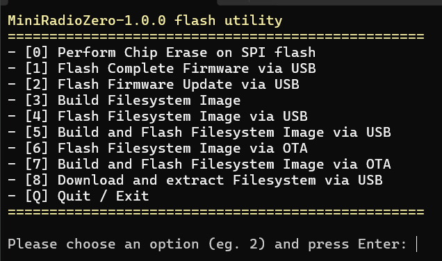
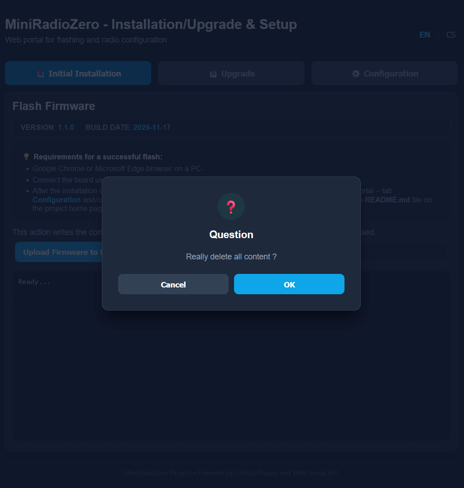
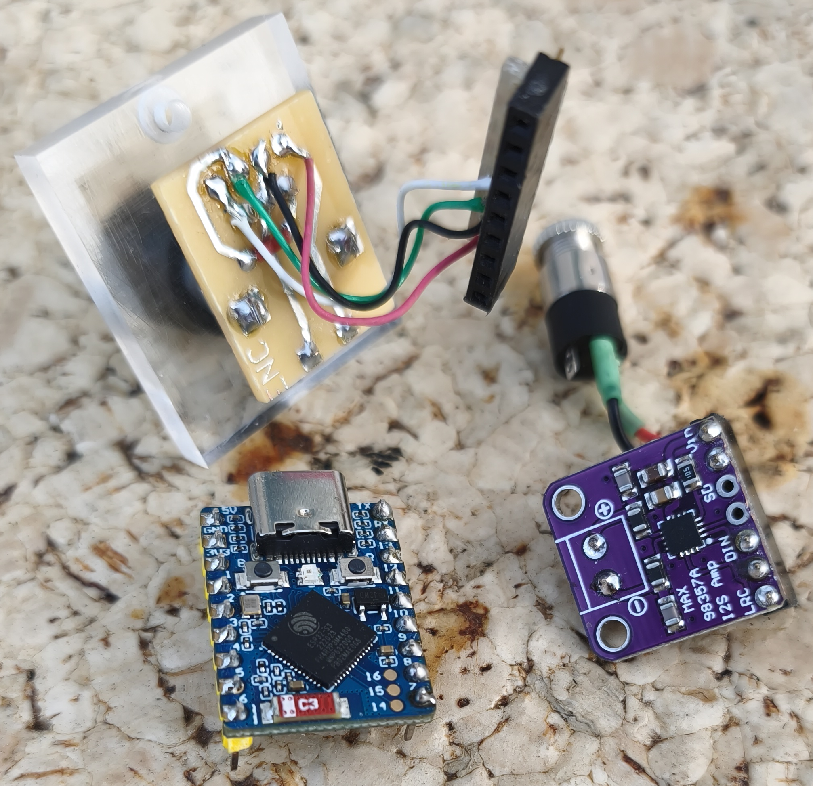
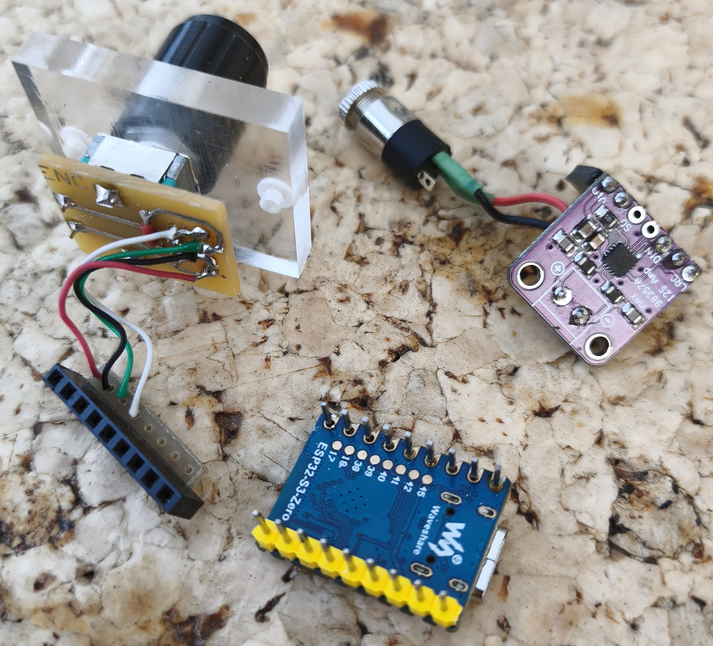
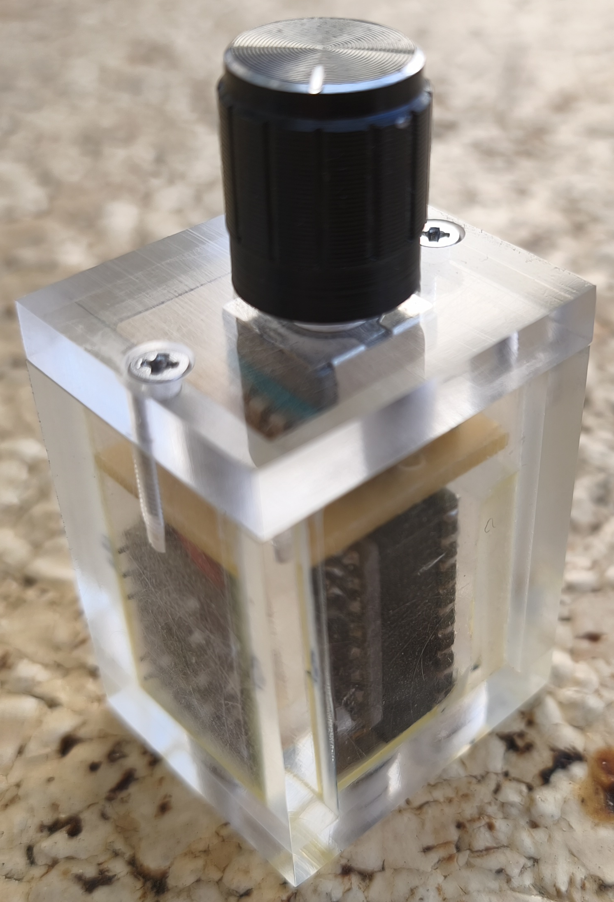
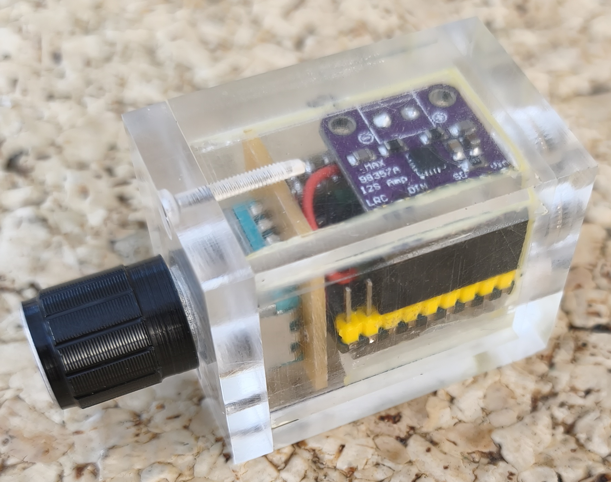
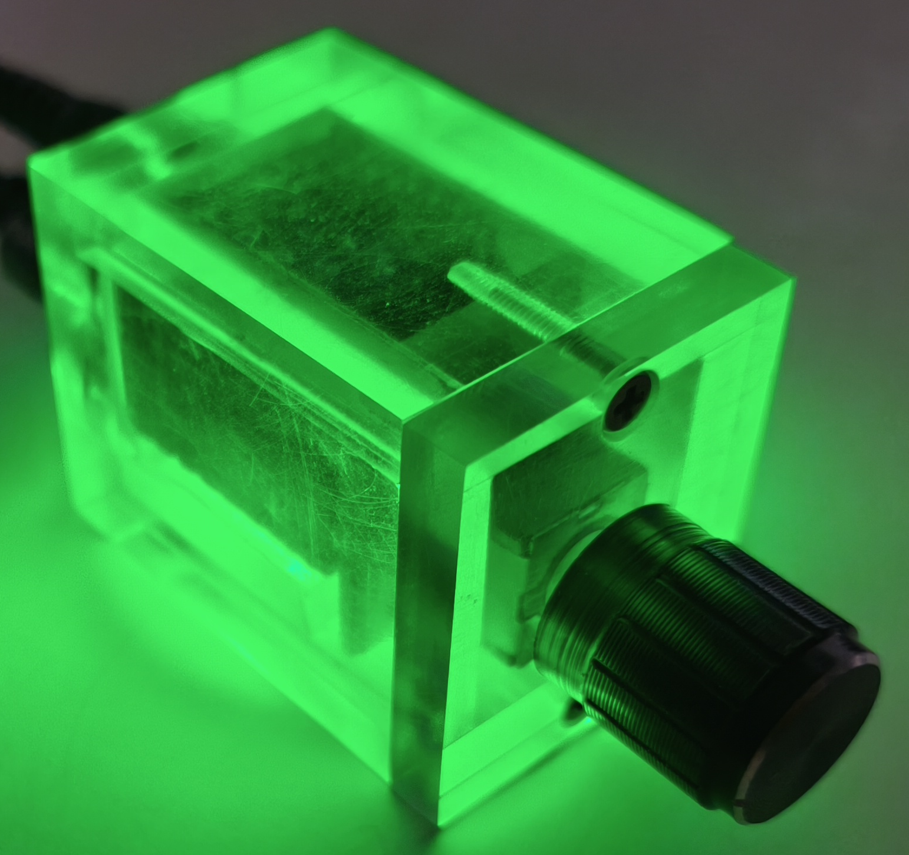
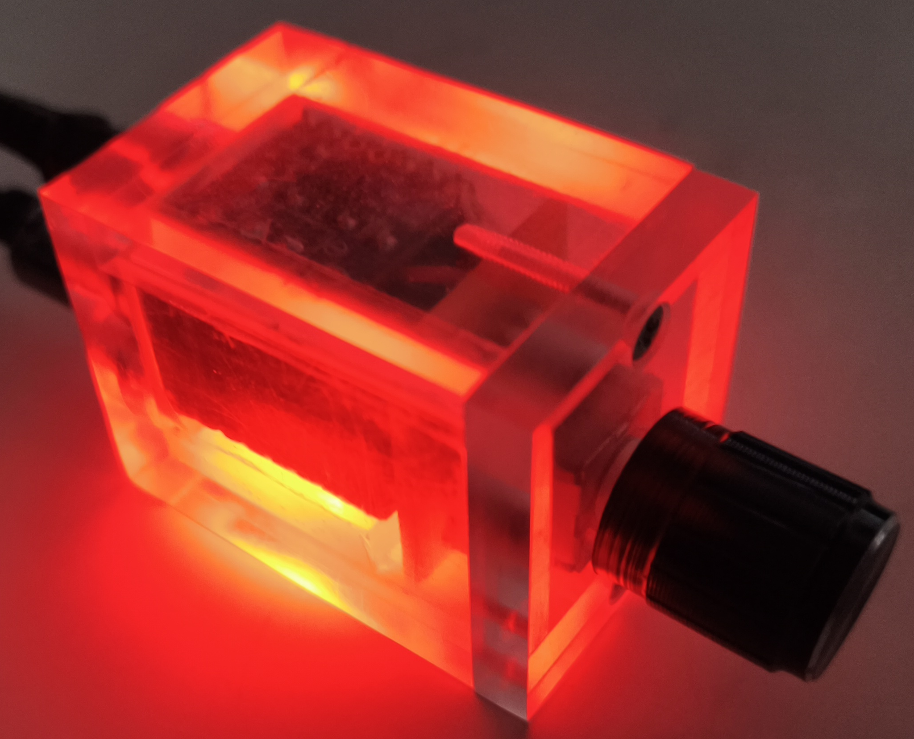

# MiniRadioZero

**MiniRadioZero** je ultraminimalistické internetové rádio bez displeje, navržené speciálně pro prostory, jako jsou kuchyně nebo dílny, kde jsou složitá uživatelská rozhraní či ovládání pomocí chytrého telefonu nepraktické. Zařízení je konstruováno jako elegantní hardwarový „sendvič“ modulů a nabízí robustní fyzické ovládání prostřednictvím jediného mechanického otočného enkodéru. O vizuální zpětnou vazbu o stavu zařízení se stará integrovaná RGB LED dioda.

Jako minimalistický protipól k mému předchozímu projektu [RadioESP32](https://github.com/Pako2/RadioESP32) (který je nabitý funkcemi), se tento projekt zbavuje veškeré zbytečné režie uživatelského rozhraní. Cílem je jediné: zajistit plynulé a spolehlivé přehrávání internetových rádiových streamů.

### Klíčové vlastnosti

- Ultrakompaktní hardwarový „sendvič“: Skládá se pouze ze tří komponent – modulu ESP32-S3 Zero, desky MAX98357A (kombinace I2S DAC převodníku a zesilovače)  a mechanického otočného enkodéru.

- Architektura „Zero-Web-Stack“: Díky úplnému odstranění vestavěného webového serveru firmware nevyžaduje náročné přepínání úloh v rámci RTOS (operačního systému reálného času), což zaručuje naprosto plynulé zpracování zvukového streamu.

- Inteligentní týdenní plánovač: Autonomní interní plánovač automaticky přepíná stanice podle uživatelem definovaného rozvrhu. Funkce automatického zrušení ztlumení (unmute) umožňuje rádiu sloužit také jako budík.

- Hardwarová efektivita: Díky promyšlenému mapování I2S GPIO pinů lze mikrokontrolér a DAC desku propojit přímo pomocí pětipinové „sendvičové“ konstrukce, bez nutnosti použití volných vodičů. Celý modul má rozměry pouhých 24 × 18 × 18 mm.

- Předvídatelné spouštění: Po zapnutí se zařízení vždy nastaví na uživatelem definovanou výchozí stanici (případně stanici nastavenou v plánovači) a bezpečnou úroveň hlasitosti, čímž se předchází nepříjemným překvapením v podobě příliš hlasitého zvuku.

- Flexibilní kapacita: Podporuje až 16 předvoleb rádiových stanic, až 8 různých Wi-Fi sítí (s plynulým automatickým přepínáním) a až 32 nezávislých položek plánovače.

- Kompletní konfigurace je definována v jediném souboru `config.json`, uloženém v souborovém systému LittleFS. To zjednodušuje pořizování záloh.

- K dispozici jsou dva speciální nástroje pro instalaci, aktualizace a nastavení. Jednak je to webový portál (najdete ho na adrese https://pako2.github.io/MiniRadioZero/portal/index.html) a jednak PowerShell script. Bližší popis obou nástrojů je součástí tohoto textu.

## Hardwarové propojení
### 1. Propojení I2S DAC modulu (MAX98357A a ESP32-S3 Zero)

Díky zvolené konfiguraci pinů (GPIO) lze moduly MAX98357A a ESP32-S3 Zero připájet (nebo spojit konektorem) přímo k sobě (zády k sobě) a vytvořit tak prostorově úsporný „sendvič“:

| **MAX98357A** | **ESP32-S3 Zero** | **Description** |
| :-: | :-: | :-: |
| LRC | GPIO 4 | Word Select / Left-Right Clock |
| BCLK | GPIO 3 | Bit Clock |
| DIN | GPIO 2 | Data In |
| GND | GND | Ground Reference |
| Vin | 5V | 5V Power Rail |

### 2. Připojení rotačního enkodéru

Rotační enkodér lze připojit k prakticky libovolným volným pinům. V tomto projektu je využita ta řada pinů, kterou neobsazuje MAX98357A. Protože v této řadě chybí fyzický zemnicí pin, je použit softwarový trik: jeden z pinů GPIO je firmwarem nastaven na nízkou úroveň (LOW), čímž funguje jako softwarová zem (`GND`) pro enkodér.

| **Encoder Pin** | **ESP32-S3 Zero** | **Description** |
| :-: | :-: | :-: |
| CLK | GPIO 10 | Encoder Clock Pulse |
| DT | GPIO 9 | Encoder Direction Data |
| SWITCH | GPIO 7 | Mechanical Push-Button |
| GND | GPIO 8 | Software-driven Ground Line |


## Konfigurační soubor (`config.json`)

Veškerá nastavení jsou definována v souboru `config.json`, jehož vzor se nachází ve složce `/data` a v zařízení je uložen v souborovém systému LittleFS.
```
{
  "defvol": 72,
  "defstat": 0,
  "hostname": "MiniRadioZero",
  "led_order": "RGB",
  "led_bright": 60,
  "led_yel_mix": 80,
  "ntp": {
    "server": "cz.pool.ntp.org",
    "interval": 15,
    "timezone": "CET-1CEST,M3.5.0,M10.5.0/3",
    "tzname": "Europe/Prague"
  },
  "radio": [
    {
      "name": "ČRo Dvojka",
      "url": "http://rozhlas.stream/dvojka_high.aac"
    },
    {
      "name": "ČRo Radiožurnál",
      "url": "https://rozhlas.stream/radiozurnal_high.aac"
    }
  ],
  "scheduler": {
    "sched_enabled": 1,
    "unmute": 1,
    "items": [
      {
        "label": "Default",
        "time": "00:00",
        "wdays": "0123456",
        "station": 0
      },
      {
        "label": "Meteor",
        "time": "08:00",
        "wdays": "6",
        "station": 0
      }
    ]
  },
  "network": [
    {
      "location": "Work",
      "wifibssid": "",
      "wifipass": "ihgf2345",
      "ssid": "Work",
      "dhcp": 1,
      "ipaddress": "",
      "subnet": "",
      "dnsadd": "",
      "gateway": ""
    },
    {
      "location": "Home",
      "wifibssid": "",
      "wifipass": "abcd9876",
      "ssid": "Home",
      "dhcp": 0,
      "ipaddress": "192.168.3.231",
      "subnet": "255.255.255.0",
      "dnsadd": "192.168.3.1",
      "gateway": "192.168.3.1"
    }
  ]
}
```

### Dokumentace parametrů

**A. Kořenové parametry**

- `defvol`: Výchozí úroveň hlasitosti nastavená ihned po zapnutí zařízení.

- `defstat`: Index výchozí rozhlasové stanice, která se načte při spuštění (pokud ji nepřepíše událost v plánovači). Načtení výchozí stanice lze vyvolat také „trojitým kliknutím“ na otočný ovladač (enkodér). Tato funkce slouží jako důležitý záchranný prvek pro případ, že uživatel ztratí přehled o tom, jaká stanice je právě naladěna.

- `hostname`: Název hostitele. Používá se pro vyhledávání v síti a identifikaci zařízení v lokální síti.

- `led_order`:  Typ vícebarevné led diody. Může mít buď hodnotu RGB anebo GRB.

- `led_bright`: Jas vícebarevné led diody v procentech. Může nabývat hodnot 0 - 100.

- `led_yel_mix`: Procentní podíl červené barvy na složení žluté. Obvykle bývá více než 50%, protože zelená barva má tendenci červenou "přebíjet". Může nabývat hodnot 0 - 100.
**B. Objekt NTP (`ntp`)**

Konfiguruje protokol SNTP (Simple Network Time Protocol), který je nezbytný pro fungování plánovače.

- `server`: Adresa cílového NTP serveru. Doporučuje se zvolit server, který je geograficky blízko (viz [NTP Pool Project Zone List](https://www.ntppool.org/zone/@)).

- `interval`: Časový interval synchronizace (v minutách).

- `timezone`: Časové pásmo ve formátu standardní proměnné prostředí POSIX (zahrnuje pravidla pro letní čas a časové posuny). Parametry pro svou oblast naleznete v [databázi POSIX TZ](https://raw.githubusercontent.com/nayarsystems/posix_tz_db/master/zones.csv).

- `tzname`: Čitelný název časového pásma, který se zobrazuje v systémových záznamech (např. `Europe/Prague`).

**C. Pole rozhlasových stanic (`radio`)**

Seznam obsahující vaše internetové rozhlasové stanice (streamy).

- `name`: Popisný název, který se vypisuje do systémových záznamů (logů).

- `url`: Přímá URL adresa streamu internetového rádia (formáty AAC, MP3 atd.).

**D. Objekt plánovače (`scheduler`)**

- `sched_enabled`: Hlavní přepínač pro aktivaci (`1`) nebo deaktivaci (`0`) automatického plánování.

- `unmute`: Pokud je nastaveno na `1`, rádio při spuštění naplánované události zkontroluje, zda není ztlumené (režim Mute). Pokud ano, automaticky zvuk zapne – díky tomu může rádio sloužit například jako budík.

- `items`: Seznam naplánovaných událostí v čase:

- `label`: Vlastní popisek pro orientaci uživatele (hlavní program jej ignoruje).

- `time`: Cílový čas provedení v přesném formátu `HH:MM`. 

- `wdays`: Dny v týdnu, kdy má pravidlo platit. Neděle je `0`, pondělí `1` atd. až po sobotu, která je `6` (např. `"0123456"` pro každý den, `"6"` pouze pro soboty). 

- `station`: Index cílové stanice ze seznamu v poli `radio` (čísluje se od `0` pro první stanici).

**E. Pole sítí (`network`)**

Seznam až 8 předkonfigurovaných Wi-Fi prostředí.

- `location`: Popisný název profilu umístění sítě (např. `"Home"` – domov, `"Work"` – práce).

- `wifibssid`: Konkrétní MAC adresa cílového přístupového bodu (Access Pointu) – používá se v případě, že více přístupových bodů sdílí stejný název SSID. Pro výchozí chování připojení ponechte prázdné.

- `wifipass`: Heslo (bezpečnostní klíč) k síti.

- `ssid`: Jedinečný název bezdrátové sítě (SSID).

- `dhcp`: Nastavte na `1` pro automatické získání síťových údajů ze serveru DHCP, nebo na `0` pro ruční zadání statické konfigurace sítě.

- `ipaddress` / `subnet` / `dnsadd` / `gateway`: Údaje pro statickou konfiguraci sítě (povinné, pokud je `dhcp` nastaveno na `0`).

## Indikace stavu pomocí RGB LED

Úvodem k tomuto odstavci je třeba poznamenat, že výrobci desek ESP32-S3-Zero nám vůbec neusnadňují práci a osazují desky dvěma druhy vícebarevných svítivých diod. Díky tomu se předchozí verzí firmware rádia mohlo stát, že místo zelené svítila dioda červeně a naopak. Proto byla (od verze 1.1.0) přidána do firmware možnost uživatelsky typ diody nastavit. Blíže viz odstavec Webový portál.
Vzhledem k tomu, že hardware funguje zcela bez displeje, slouží vícebarevná RGB LED (integrovaná přímo na desce ESP32-S3 Zero na pinu `GPIO 21`) k poskytování vizuální zpětné vazby v reálném čase o každé probíhající operaci:

| **Barva LED** | **Stav zařízení** | **Popis** |
| :-: | :-: | :-: |
| Žlutá | Spouštění / Synchronizace | Počáteční stav po zapnutí. Zařízení čeká na přidělení lokální IP adresy prostřednictvím Wi-Fi a/nebo na synchronizaci času ze serveru NTP. |
| Bílá | Nouzový přístupový bod (AP) | V okolí nebyly nalezeny žádné známé Wi-Fi sítě. Zařízení se automaticky přepne do režimu přístupového bodu (Access Point – AP) pro účely konfigurace a obnovení provozu. |
| Zelená | Aktivní přehrávání | Běžný provozní stav. Stream internetového rádia je aktivně připojen a přehráván prostřednictvím převodníku I2S DAC. |
| Červená | Zvuk ztlumen | Zvukový výstup byl uživatelem aktivně ztlumen (funkce `Mute`). |
| Modrá | Výběr stanice / Automatické přepnutí | Režim ladění nebo změny stanice. Aktivuje se buď ručně dvojitým kliknutím na otočný ovladač (enkodér), nebo automaticky v okamžiku, kdy nastane naplánovaná událost. |
| Fialová | Obnovení výchozí stanice | Potvrzuje akci trojitého kliknutí; signalizuje, že zařízení provádí vynucený návrat (hard reset) na přednastavenou výchozí stanici. |


## Chytrý týdenní plánovač a budík
### ***Už nikdy nezmeškáte svůj oblíbený rozhlasový pořad!***

Autonomní interní plánovací mechanismus automaticky přepíná přikímané streamy v průběhu celého týdne na základě vašich preferencí zadaných v rozvrhu. Každý jednotlivý blok v rozvrhu obsahuje řetězec, který určuje dny v týdnu, pro něž je daný blok platný.
Vysvětlení jednotlivých parametrů pro každý blok naleznete v kapitole „Dokumentace parametrů / Objekt plánovače“ (Parameter Documentation/Scheduler Object). Zde uvedu jen podrobnější informace o významu globálních parametrů plánovače:

- `sched_enabled`: Pokud je nastaveno na `1`, interní časovač vyhodnocuje položky v rozvrhu. Pokud je nastaveno na `0`, plánovač je zcela deaktivován a zařízení zůstává trvale na stanici zvolené uživatelem (nebo na výchozí stanici).
- `unmute`: Tento parametr řídí adaptivní chování rádia v režimu budíku. Pokud událost v časové ose obsahuje příkaz `unmute: 1`, firmware zkontroluje, zda je zařízení aktuálně ztlumeno. Pokud ano, aktivně zruší stav ztlumení (`Mute`) a obnoví zvukový výstup na provozní úroveň, čímž se zařízení promění v plně autonomní budík. Při nastavení na `0` rádio sice na pozadí přepne stanici, ale zvukový výstup zůstane zcela ztlumený (v případě, že ztišaní bylo aktivní).


## Ovládání pomocí otočného enkodéru a gesta

Jediný mechanický otočný enkodér zajišťuje obsluhu celého uživatelského rozhraní prostřednictvím kontextových akcí a různých způsobů stisknutí:

- **Běžný provoz:**

- *Otáčení knoflíkem:* Snižuje nebo zvyšuje celkovou hlasitost. 

- *Jedno stisknutí:* Okamžitě přepíná mezi aktivním přehráváním (zelená barva) a ztlumeným stavem (červená barva).

- **Výběr stanice (dvojité stisknutí):**

- *Dvojité stisknutí:* Aktivuje režim ladění (modrá barva). 

- *Ladění:* Otáčením knoflíku procházíte seznamem naprogramovaných stanic (uživatel musí počítat jednotlivé mechanické kroky/cvaknutí „naslepo“). 

- *Potvrzení:* Jedním stisknutím tlačítka enkodéru potvrdíte výběr a aktivujete zvolenou stanici. LED indikátor se vrátí do stavu aktivního přehrávání (zelená barva).

- **Nouzový reset (trojité stisknutí):**

- *Trojité stisknutí:* Pokud při procházení stanic „naslepo“ ztratíte přehled o tom, na které pozici se nacházíte, trojité stisknutí okamžitě přepne rádio zpět na výchozí stanici (definovanou jako `"defstat"` v souboru `config.json`).

- **Hardwarový reset (dlouhé stisknutí):**

- *Podržení po dobu 4 sekund:* Spustí kompletní restart hardwarového systému.

## Nástroje pro nasazení, flashování a konfiguraci
K dispozici jsou dva různé nástroje: webový portál a PowerShell script. Počáteční instalaci, aktualizace a do jisté míry i konfiguraci lze provádět oběma z nich. Každý z nich má své výhody i nevýhody a v některých situacích se tedy mohou i dobře doplňovat.

### PowerShell script - "flash utility"
Příprava hardwarového prostředí je plně zefektivněna díky automatizovanému instalačnímu frameworku založenému na PowerShellu.

**Pokyny k nastavení:**

1. Stáhněte si přímo nejnovější kompilovaný balíček pro nasazení: [MiniRadioZero_bundle.zip](https://github.com/Pako2/MiniRadioZero/releases/latest/download/MiniRadioZero_bundle.zip).

2. Rozbalte archiv ZIP do složky vašeho lokálního vývojového prostředí (např. `MiniRadioZero-tool`).

3. Vraťte se do kořenové složky `MiniRadioZero-tool` a spusťte ovládací rozhraní spuštěním souboru `start.bat`.

4. Otevře se terminál s ovládacím panelem automatizovaného nástroje v PowerShellu:
<p float="left">

</p>

5. Připojte hardwarový modul ESP32-S3 Zero k pracovní stanici pomocí datového USB kabelu.

6. Zvolte možnost `[1] Flash Complete Firmware via USB` (Flashování kompletního firmwaru přes USB) pro zápis hlavního zavaděče (bootloaderu), rozvržení oddílů a aplikačních vrstev.

7. Přejděte do této složky. Ve složce `/filesystem/` vyhledejte soubor `config.json` a pomocí textového editoru do něj doplňte údaje pro vaše prostředí. 

    - ***Pole profilů stanic zde slouží slouží jako šablony – analogickým způsobem můžete nastavit až 16 oblíbených internetových streamů.***

    - ***Profily bezdrátových sítí jsou také šablony – můžete zde nastavit až 8 nezávislých Wi-Fi sítí (lokací).***

8. Zvolte možnost `[5] Build and Flash Filesystem Image via USB` (Vytvoření a flashování obrazu souborového systému přes USB) pro zabalení a nasazení vašeho lokálního souboru `config.json` na oddíl LittleFS.

Jakmile proces skončí, rádio se okamžitě spustí, připojí se k nejbližší dostupné Wi-Fi síti, synchronizuje čas pomocí protokolu NTP a začne přehrávat stream!

**Poznámka** (zejména pro uživatele, preferující "klikací prostředí"): kroky 7 a 8 je možné nahradit použitím webového portálu

### Webový portál
Na adrese https://pako2.github.io/MiniRadioZero/portal/index.html se nachází webový portál. Lze ho použít pro počáteční instalaci, aktualizace i nastavení. Tento portál ale pracuje jen s prohlížeči Google Chrome a Microsoft Edge a to jen na PC, nikoliv na telefonech.
Největší výhodou je, že do PC není třeba instalovat žádný software. Několik ukázkových screenshotů webového portálu si můžete prohlédnout v této animaci:
<p float="left">

</p>

**Postup**
1. Připojte hardwarový modul ESP32-S3 Zero k pracovní stanici pomocí datového USB kabelu.
2. Na kartě `Initial Installation` stiskněte tlačítko `Upload Firmware to Radio`.
3. Na kartě `Configuration` proveďte nastavení. Všechno je dostatečně intuitivní a nepotřebuje podrobnější popis.
4. Na stejné kartě se nachází tlačítko `Calibrate LED`. Po jeho stisknutí se otevře dialog, pomocí kterého je možné vícebarevnou svítivou diodu zkalibrovat. Protože výrobci osazují desky ESP32-S3-Zero dvěma různými druhy LED, je třeba nejprve určit její druh. To se provede stisknutím tlačítka `Lit up red` nebo `Lit up green`. Následně se pomocí dvou posuvníků nastaví jas diody a odstín žluté barvy.
5. Doporučený krok - stiskněte tlačítko `Save to File`. Záloha nastavení se vždy hodí.
6. Stiskněte tlačítko `Write to Radio`. Dojde k uploadu konfigurace a restartu ESP32.
Pokud bylo nastavení provedeno správně (zejména alespoň jedna platná Wi-Fi síť a alespoň jedna platná stanice), tak po restartu se rádio okamžitě spustí, připojí se k nejbližší dostupné Wi-Fi síti, synchronizuje čas pomocí protokolu NTP a začne přehrávat stream!

### Kombinace obou nástrojů
Z předchozího popisu se může zdát, že veškerá komunikace s ESP32 probíhá výhradně "po kabelu". Ale není to pravda. PowerShell script může totiž komunikovat s ESP32 i bez kabelu a to pomocí "OTA". To se samozřejmě hodí zejména v případech, kdy rádio je umístěné někde na poličce mimo dosah PC. Aby to bylo možné praktikovat, je třeba v PC mít uloženu kopii konfiguračního souboru config.json.

**Postup při dodatečných úpravách nastavení bez připojení kabelem**
1. Otevřete webový portál https://pako2.github.io/MiniRadioZero/portal/index.html, přejděte na záložku `Configuration` a stiskněte tlačítko `Read from File`. Vyberte správný záložní soubor a otevřete ho.
2. Proveďte potřebné úpravy nastavení.
3. Stiskněte tlačítko `Save to File`. Soubor config.json uložte do složky `firmware` (viz instalace PowerShell scriptu - "flash utility").
4. Spusťte PowerShell script (pomocí souboru start.bat).
5. V nabídce vyberte položku `[7] Build and Flash Filesystem Image via OTA`. Zadejte IP adresu rádia. Dojde k "uploadu" konfigurace do rádia. 

## Knihovny třetích stran a poděkování
Tento projekt je silně závislý na komunitě open-source. Rád bych vyjádřil upřímné poděkování autorům následujících výjimečných knihoven, jejichž usilovná práce umožnila vznik tohoto projektu:

- **[ESP32-audioI2S](https://github.com/schreibfaul1/ESP32-audioI2S) od autora schreibfaul1** – Klíčová součást zajišťující vysoce výkonné streamování internetového rádia.

- **[NeoPixel](https://github.com/adafruit/adafruit_neopixel) od společnosti Adafruit** – Nezbytná knihovna pro ovládání RGB LED diod.

- **[ArduinoJson](https://github.com/bblanchon/ArduinoJson) od autora bblanchon** – Používá se pro rychlé a paměťově úsporné zpracování konfiguračního souboru.

- **[esptool-js](https://github.com/espressif/esptool-js) od společnosti espressif** – Javascript implementation of flasher tool for Espressif chips, running in web browser using WebSerial.

## Slideshow (včetně ukázky ručně dělané krabičky z PMMA)
Níže naleznete galerii hotového, kompletně sestaveného modulu **MiniRadioZero**.

Hardware byl záměrně navržen tak, aby jej bylo možné snadno sestavit i bez použití 3D tiskárny. Příkladem je konstrukce z 5mm desky z polymethylmethakrylátu (PMMA / plexisklo), přičemž všechny hlavní spoje jsou lepené. Pouze panel, v němž je umístěn mechanický otočný enkodér, je připevněn pomocí dvou šroubů zašroubovaných přímo do závitů vyřezaných v bočních deskách konstrukce.

Díky vynikajícím optickým vlastnostem PMMA se celé pouzdro mění ve svítící artefakt, poskytující ambientní světelnou signalizaci.








### Licence
Části kódu vytvořené autorem projektu **MiniRadioZero** jsou licencovány pod licencí [GPL-3.0](LICENSE). Knihovny třetích stran použité v tomto projektu podléhají odlišným licenčním podmínkám – doporučujeme vám seznámit se i s nimi.