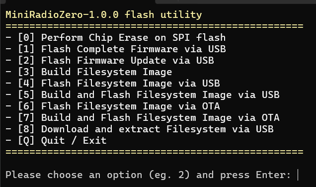
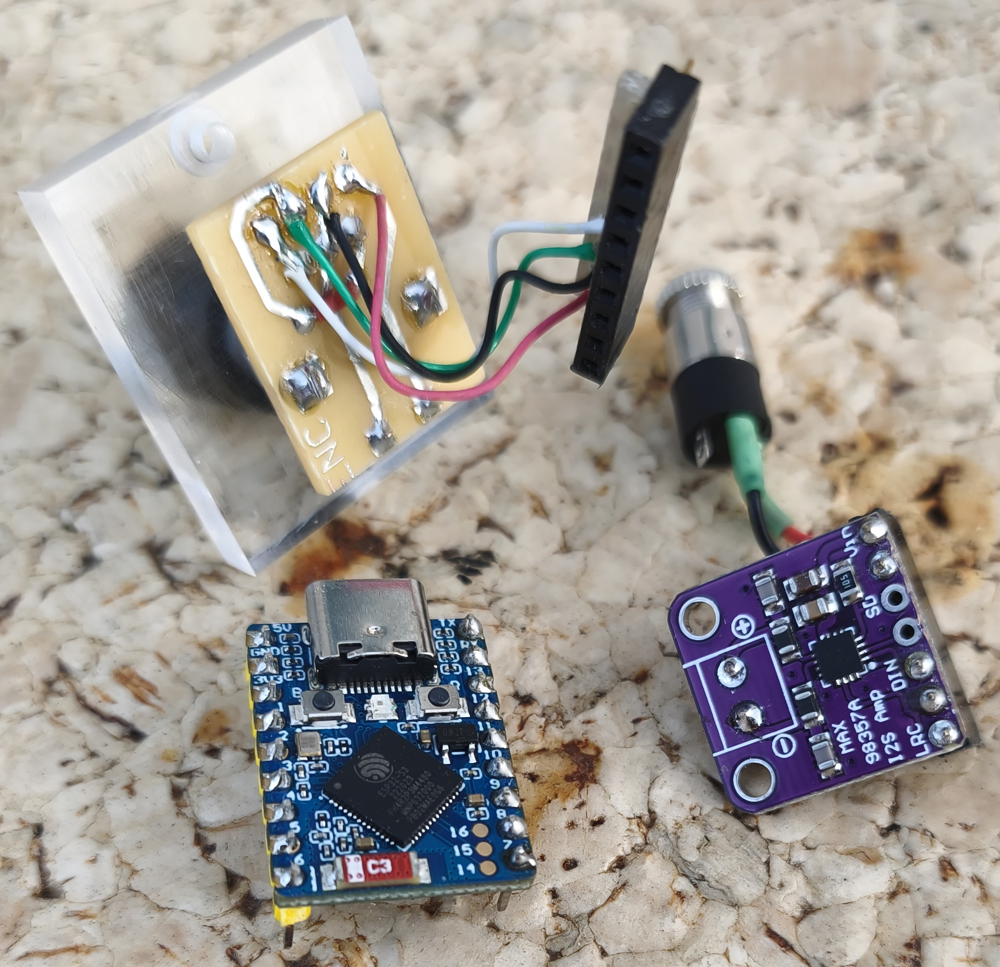
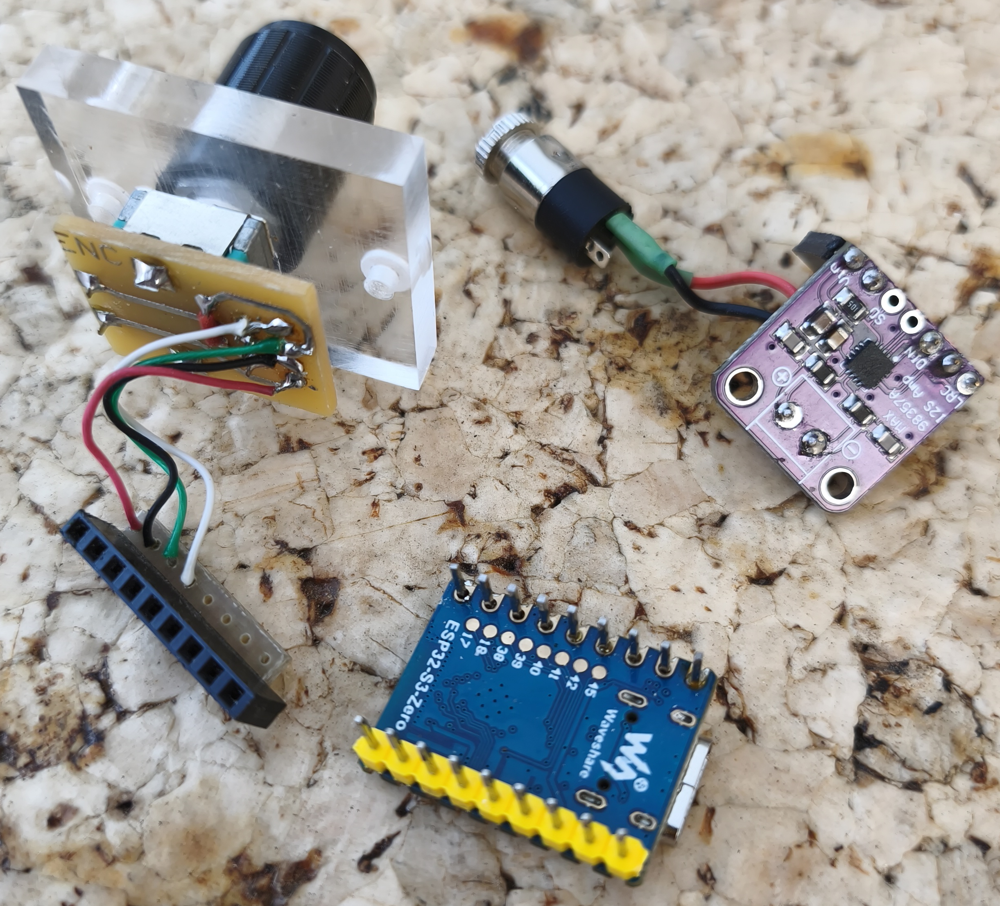
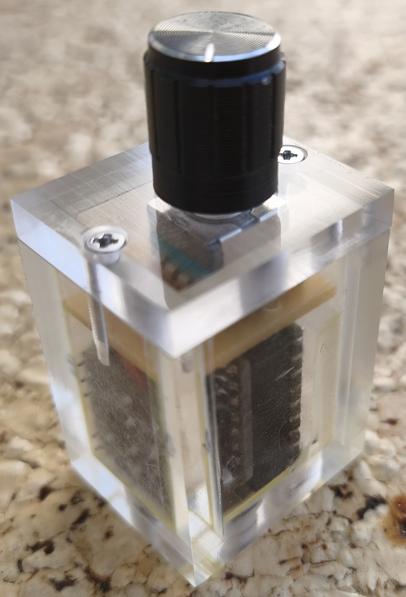
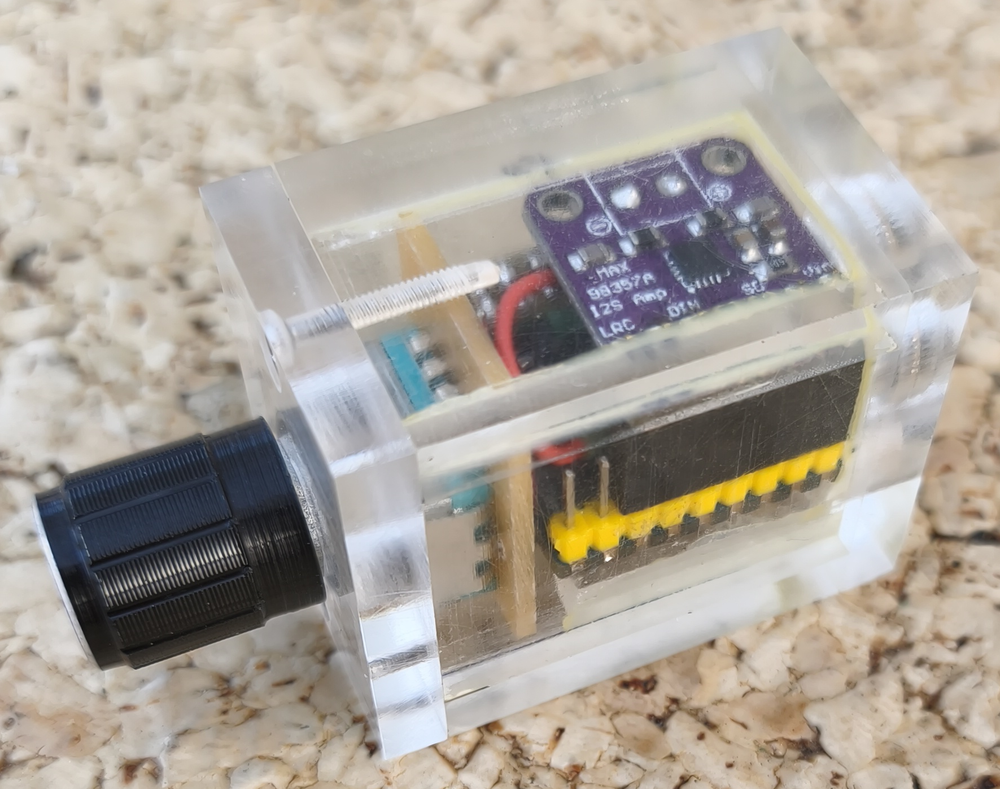
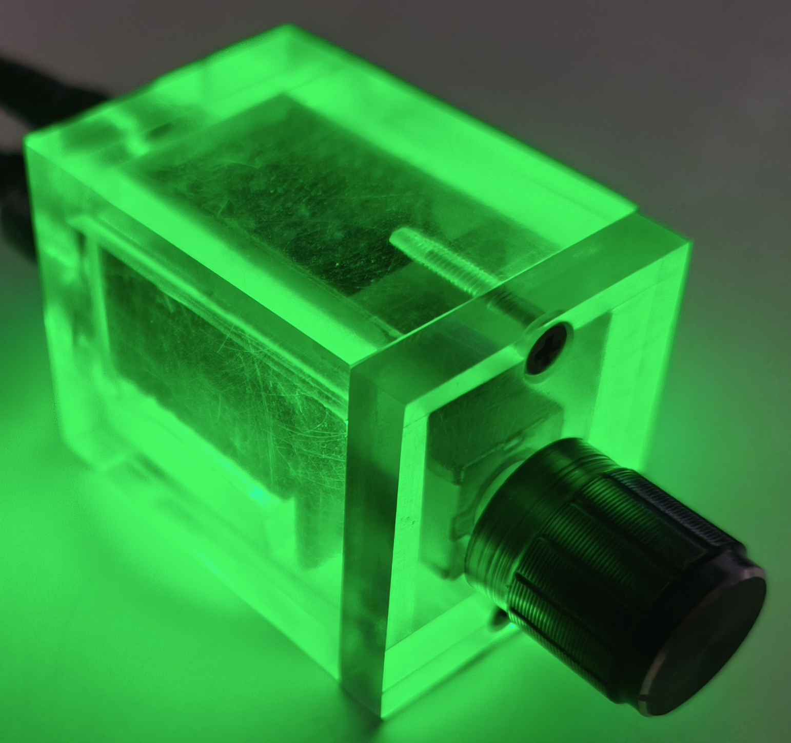
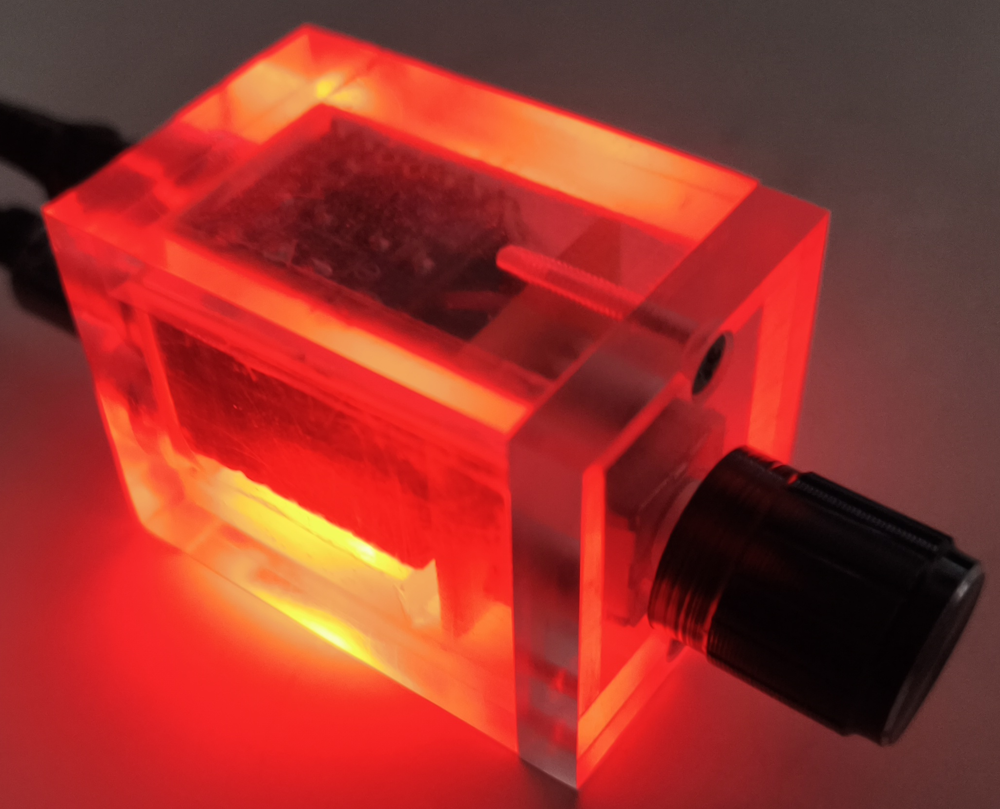

# MiniRadioZero

**MiniRadioZero** is an ultra-minimalist, screenless internet radio designed specifically for spaces like kitchens or workshops where complex interfaces or smartphone apps are impractical. Built as a sleek hardware "sandwich" modules, it offers robust physical control using a single mechanical rotary encoder, utilizing a native status RGB LED for full operational feedback.

As a minimalist counterweight to the feature-heavy RadioESP32 platform, this project strips away interface overhead to focus entirely on seamless, predictable web-stream playback.

### Key Features

- Ultra-Compact Hardware Sandwich: Composed of just three components: an ESP32-S3 Zero, a MAX98357A I2S DAC/Amplifier board, and a mechanical rotary encoder.

- "Zero-Web-Stack" Architecture: By completely eliminating an embedded web server, the firmware requires no heavy RTOS task switching, ensuring perfectly smooth audio stream processing.

- Smart Weekly Scheduler & Alarm: An autonomous internal time planner automatically switches stations based on user-defined schedules. Features a global `unmute` flag to automatically restore sound, enabling the radio to serve as a reliable morning alarm clock.

- Hardware Efficiency: Strategic I2S GPIO mapping allows the microcontroller and DAC boards to connect directly via a 5-pin sandwich layout with no loose wiring. The entire module measures just 24 x 18 x 18 mm.

- Predictable Initialization: The device turns on to a user-defined default station and preset safe volume level every time, eliminating sudden high-volume surprises.

- Flexible Capacity: Supports up to 16 preset radio stations, 8 distinct Wi-Fi networks (with smooth auto-switching), and 32 independent scheduler profiles.

- LittleFS & PowerShell Lifecycle: Non-volatile configuration is managed entirely through a clean `config.json` file inside the LittleFS file system. A dedicated PowerShell Flash tool handles wired provisioning, LittleFS management, and Over-the-Air (OTA) configurations.


## Hardware Interconnections

### 1. I2S DAC Sandwich Connection (MAX98357A to ESP32-S3 Zero)

By selecting this exact GPIO configuration, the MAX98357A and the ESP32-S3 Zero boards can be soldered directly together back-to-back as a space-saving hardware sandwich:

| **MAX98357A** | **ESP32-S3 Zero** | **Description** |
| :-: | :-: | :-: |
| LRC | GPIO 4 | Word Select / Left-Right Clock |
| BCLK | GPIO 3 | Bit Clock |
| DIN | GPIO 2 | Data In |
| GND | GND | Ground Reference |
| Vin | 5V | 5V Power Rail |

### 2. Rotary Encoder Connection

The rotary encoder can be attached to virtually any free pins. This project uses the opposite pin header row. Because this specific row lacks a hardware ground pin, a software trick is applied: one GPIO is driven LOW by the firmware to act as a dedicated software ground (`GND`) for the encoder.

| **Encoder Pin** | **ESP32-S3 Zero** | **Description** |
| :-: | :-: | :-: |
| CLK | GPIO 10 | Encoder Clock Pulse |
| DT | GPIO 9 | Encoder Direction Data |
| SWITCH | GPIO 7 | Mechanical Push-Button |
| GND | GPIO 8 | Software-driven Ground Line |


## Configuration File (`config.json`)

All runtime settings are defined in a `config.json` template located within the `/data` directory and deployed via LittleFS.
```
{
  "defvol": 72,
  "defstat": 0,
  "hostname": "MiniRadioZero",
  "ntp": {
    "server": "cz.pool.ntp.org",
    "interval": 15,
    "timezone": "CET-1CEST,M3.5.0,M10.5.0/3",
    "tzname": "Europe/Prague"
  },
  "radio": [
    {
      "name": "ČRo Dvojka",
      "url": "http://rozhlas.stream/dvojka_high.aac"
    },
    {
      "name": "ČRo Radiožurnál",
      "url": "https://rozhlas.stream/radiozurnal_high.aac"
    }
  ],
  "scheduler": {
    "sched_enabled": 1,
    "unmute": 1,
    "items": [
      {
        "label": "Default",
        "time": "00:00",
        "wdays": "0123456",
        "station": 0
      },
      {
        "label": "Meteor",
        "time": "08:00",
        "wdays": "6",
        "station": 0
      }
    ]
  },
  "network": [
    {
      "location": "Work",
      "wifibssid": "",
      "wifipass": "ihgf2345",
      "ssid": "Work",
      "dhcp": 1,
      "ipaddress": "",
      "subnet": "",
      "dnsadd": "",
      "gateway": ""
    },
    {
      "location": "Home",
      "wifibssid": "",
      "wifipass": "abcd9876",
      "ssid": "Home",
      "dhcp": 0,
      "ipaddress": "192.168.3.231",
      "subnet": "255.255.255.0",
      "dnsadd": "192.168.3.1",
      "gateway": "192.168.3.1"
    }
  ]
}
```


### Parameter Documentation

**A. Root Parameters**

- `defvol`: The default volume level initialized immediately upon power-up.

- `defstat`: The default radio station index loaded at startup (if no scheduler event overrides it) or immediately triggered via an encoder "triple-click". This serves as a vital blind rescue control if the user loses track of the current channel.

- `hostname`: Used for network discovery and local identity mapping.

**B. NTP Object (`ntp`)**

Configures the Simple Network Time Protocol (SNTP) required for the scheduler engine.

- `server`: The target NTP server address. Geographically close servers are recommended (see the [NTP Pool Project Zone List](https://www.ntppool.org/zone/@)).

- `interval`: The time synchronization interval defined in minutes.

- `timezone`: The standard POSIX environment variable format for daylight saving time (DST) and time offsets. Find your zone parameters in the [POSIX TZ Database](https://raw.githubusercontent.com/nayarsystems/posix_tz_db/master/zones.csv).

- `tzname`: A human-readable string identifying the timezone for logging output (e.g., `Europe/Prague`).

**C. Radio Array (`radio`)**

A list containing your internet radio streams.

- `name`: A descriptive name printed out to the system logs.

- `url`: The raw internet radio stream stream URL address (AAC, MP3, etc.).

**D. Scheduler Object (`scheduler`)**

- `sched_enabled`: Master switch to enable (`1`) or disable (`0`) automated scheduling.

- `unmute`: If set to `1`, the radio will actively check for an active Mute state when a schedule item triggers. If muted, it will force-unmute the audio path, allowing the radio to function as a morning alarm clock.

- `items`: An array of scheduled timeline events:

  - `label`: A custom description token for user reference (ignored by the core program).

  - `time`: The execution target time in strict `HH:MM` format.

  - `wdays`: Active days of the week where the rule applies. Sunday is `0`, Monday is `1`, through to Saturday as `6` (e.g., `"0123456"` for daily, `"6"` for Saturdays only).

  - `station`: The target station index from the `radio` array list (starting at `0` for the first station).

**E. Network Array (`network`)**

A list of up to 8 pre-configured Wi-Fi environments.

- `location`: A descriptive name for the network location profiles (e.g., `"Home"`, `"Work"`).

- `wifibssid`: The specific MAC address of the target Access Point (used if multiple APs share an identical SSID name). Leave blank for default connection behaviors.

- `wifipass`: The password security key for the network.

- `ssid`: The unique network wireless SSID broadcast name.

- `dhcp`: Set to `1` to receive network details automatically via a DHCP server pool, or `0` for manual static network provisioning.

- `ipaddress` / `subnet` / `dnsadd` / `gateway`: Static network configuration strings (mandatory if `dhcp` is set to `0`).


## Status RGB LED Indications

Since the hardware operates completely without a screen, a multi-color RGB status LED (built natively onto the ESP32-S3 Zero board at `GPIO 21`) provides real-time optical feedback for every operation:

| **LED Color** | **Device State** | **Description** |
| :-: | :-: | :-: |
| Yellow | Booting / Synchronizing | Initial state upon power-up. The radio is waiting to be assigned a local IP address via Wi-Fi and/or waiting for time synchronization from the NTP server. |
| White | Fallback Access Point | No known Wi-Fi networks were detected in the environment. The radio automatically drops into emergency Access Point (AP) mode for recovery configuration. |
| Green | Active Playback | Normal operating state. An internet radio stream is actively connected and playing over the I2S DAC. |
| Red | Audio Muted | The audio output layer has been actively muted by the user (`Mute`). |
| Blue | Station Selection / Auto-Switch | Active channel tuning mode. This triggers either manually via an encoder double-click or automatically when a scheduled timeline event fires. |
| Purple | Default Channel Reset | Confirms a triple-click action, indicating the radio is actively forcing a hard reset back to the preset default station. |


## Smart Weekly Scheduler & Alarm
### ***You will never miss your favorite radio show again !***

An autonomous internal scheduling mechanism automatically adjusts broadcast streams throughout the week based on your preferences within the schedule. Each individual block in the schedule contains a string that specifies the days of the week for which that block is valid.  
Explanations of the individual parameters for each block can be found in the "Parameter Documentation/Scheduler Object" chapter. Here, I will provide further details regarding the significance of the scheduler's global parameters:

- `sched_enabled`: When set to `1`, the internal clock loop evaluates schedule entries. When set to `0`, the planner is completely disabled, and the device rests exclusively on the user-selected or default channel.

- `unmute`: This parameter governs the radio's adaptive alarm behavior. When a timeline event fires with `unmute: 1`, the firmware tests if the device is currently muted. If so, it actively overrides the `Mute` state and restores the audio line to its operational level, transforming the hardware into a fully autonomous morning wake-up alarm. If set to `0`, the radio will switch station arrays in the background, but the audio output remains completely silent.


## Rotary Encoder Controls & Gestures

A single mechanical rotary encoder handles the entire user interface loop using distinct context actions and click gestures:

- **Standard Operation:**

  - *Rotating Knob:* Decreases or increases the master volume level.

  - *Single Click:* Instantly toggles the audio path between active playback (Green) and muted silence (Red).

- **Station Selection (Double-Click):**

  - *Double-Click:* Enters tuning mode (Blue).

  - *Tuning:* Rotate the knob to scroll through your programmed station indexing pool (users must count the physical detent steps "blindly").

  - *Confirmation:* Press the encoder button once to lock in and initialize the chosen station. The LED returns to active Green.

- **Blind Rescue Reset (Triple-Click):**

  - *Triple-Click:* If you lose track of your current index location while scrolling blindly, a quick triple-click forces an immediate channel jump directly back to the secure default station specified as `"defstat"` within your `config.json`.

- **Hardware Reset (Long Press):**

  - *4-Second Hold:* Triggers a low-level hardware system restart sequence.


## Deployment & Production Flash Utility

Provisioning the hardware environment is fully streamlined using an automated PowerShell installer framework.

**Setup Instructions:**

1. Download the latest compiled deployment bundle directly: [MiniRadioZero_bundle.zip](https://github.com/Pako2/MiniRadioZero/releases/latest/download/MiniRadioZero_bundle.zip).

2. Extract the ZIP archive into your local development workspace folder (e.g., `MiniRadioZero-tool`).

3. Navigate into the workspace directory. Under the `/filesystem/` directory, locate the raw `config.json` template and modify it using a text editor to include your environment credentials.

   - ***The station profile arrays are placeholders – you can populate them with up to 16 favorite internet streams.***

   - ***The wireless profiles are templates – you can map up to 8 independent Wi-Fi locations.***

4. Return to the root `MiniRadioZero-tool` folder and execute the controller host shell by running `start.bat`.

5. The automated PowerShell utility dashboard terminal will launch:
<p float="left">
  
</p>
6. Connect the ESP32-S3 Zero hardware module to your workstation using a direct USB data link cable.

7. Select Option `[1] Flash Complete Firmware via USB` to write the master bootloader, structural partition layouts, and application layers.

8. Select Option `[5] Build and Flash Filesystem Image via USB` to pack and deploy your local `config.json` profile onto the LittleFS partition.

Once completed, the radio will boot immediately, establish a connection to your nearest available Wi-Fi profile, initialize its time engine via NTP, and begin streaming!


## Third-Party Libraries & Acknowledgments
This project relies heavily on the open-source community. I would like to express my sincere gratitude to the authors of the following exceptional libraries, whose hard work made this multi-boot platform possible:

- **[ESP32-audioI2S](https://github.com/schreibfaul1/ESP32-audioI2S) by schreibfaul1** – The core engine powering the high-performance internet radio streaming.

- **[NeoPixel](https://github.com/adafruit/adafruit_neopixel) by Adafruit** – Essential for driving the RGB led.

- **[ArduinoJson](https://github.com/bblanchon/ArduinoJson) by bblanchon** – Used for fast, memory-efficient parsing of configuration file.


## Showcase & Custom PMMA Enclosure

Below is a gallery displaying the completed, fully assembled **MiniRadioZero** module.

Because this hardware was intentionally developed to be built easily without a 3D printer, the structural chassis was crafted from a 5mm polished polymethyl methacrylate (PMMA / Plexiglass) sheet, with all primary joints securely bonded. The top interface wall hosting the mechanical rotary encoder is fastened via dual machine screws threaded directly into custom taps cut right into the 5mm structural side plates.

Due to the pristine refractive properties of the polished PMMA housing, the embedded RGB status indicator acts as an internal prism, turning the entire enclosure into a glowing, translucent ambient indicator light.








### License
The code parts written by the author of the **MiniRadioZero** project are licensed under [GPL-3.0](LICENSE), 3rd party libraries that are used by this project are licensed under different license schemes, please check them out as well.

