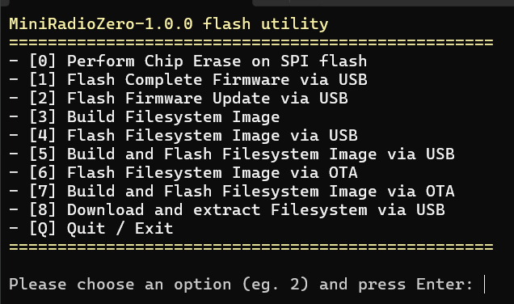
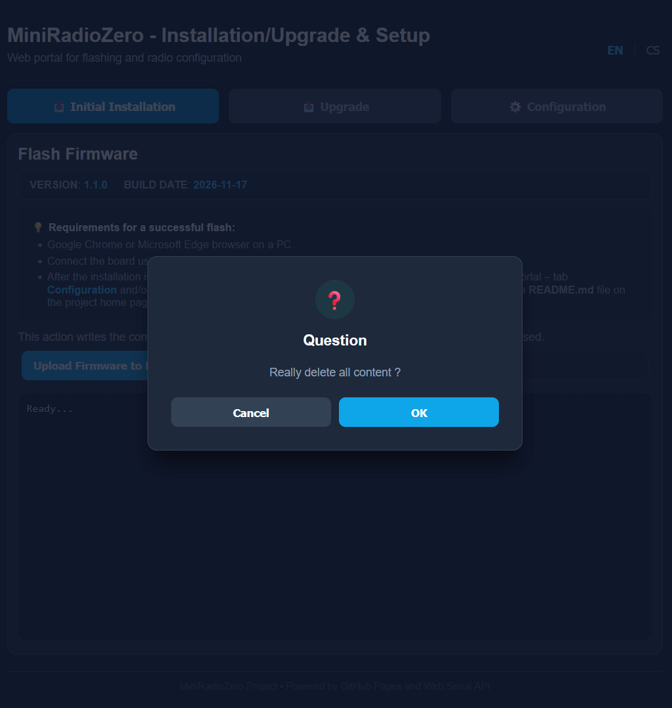
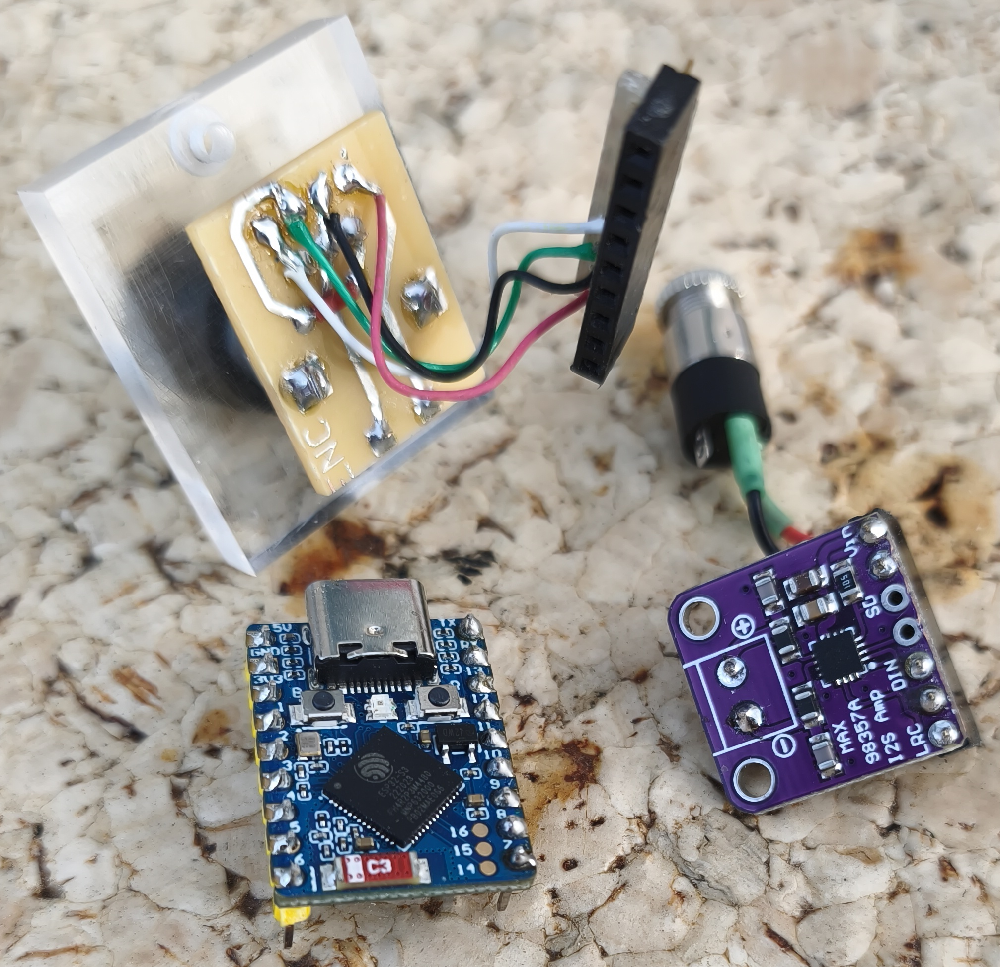
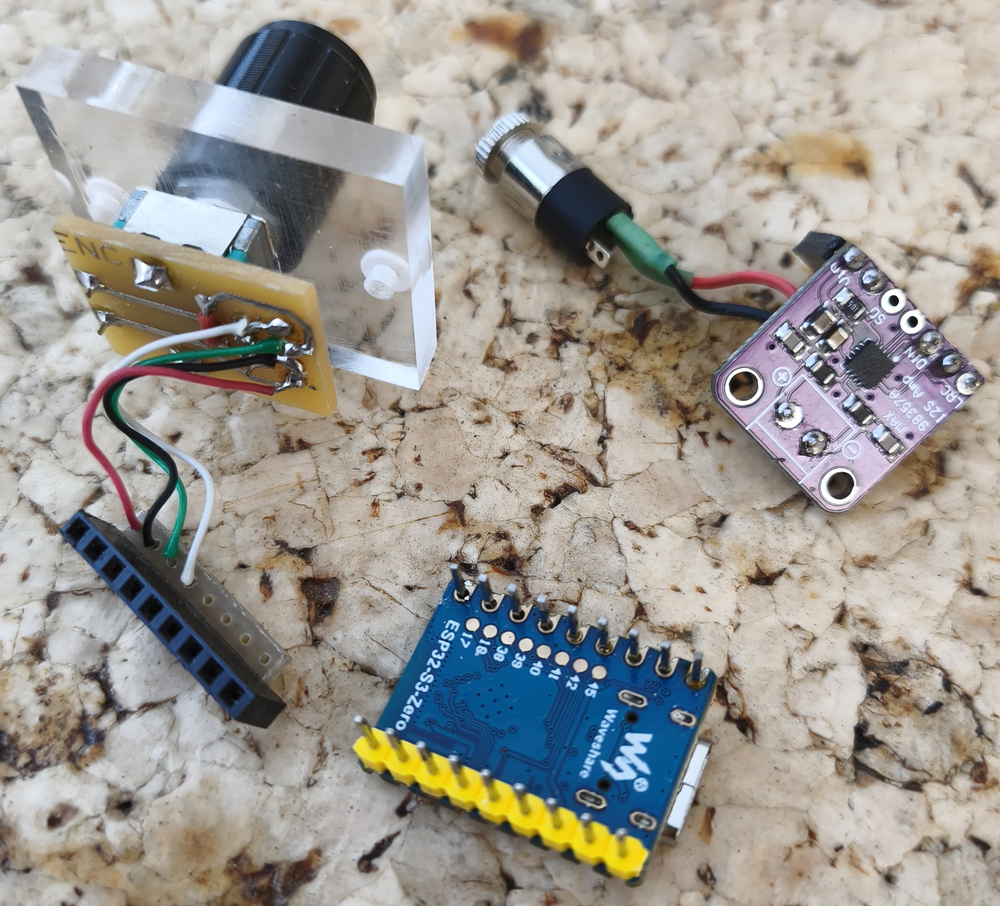
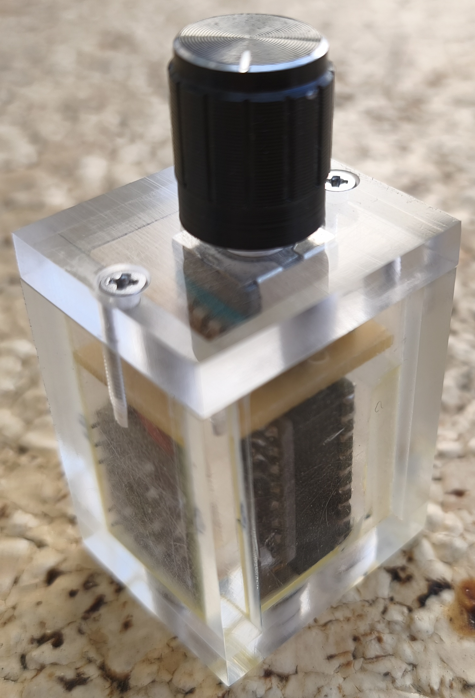
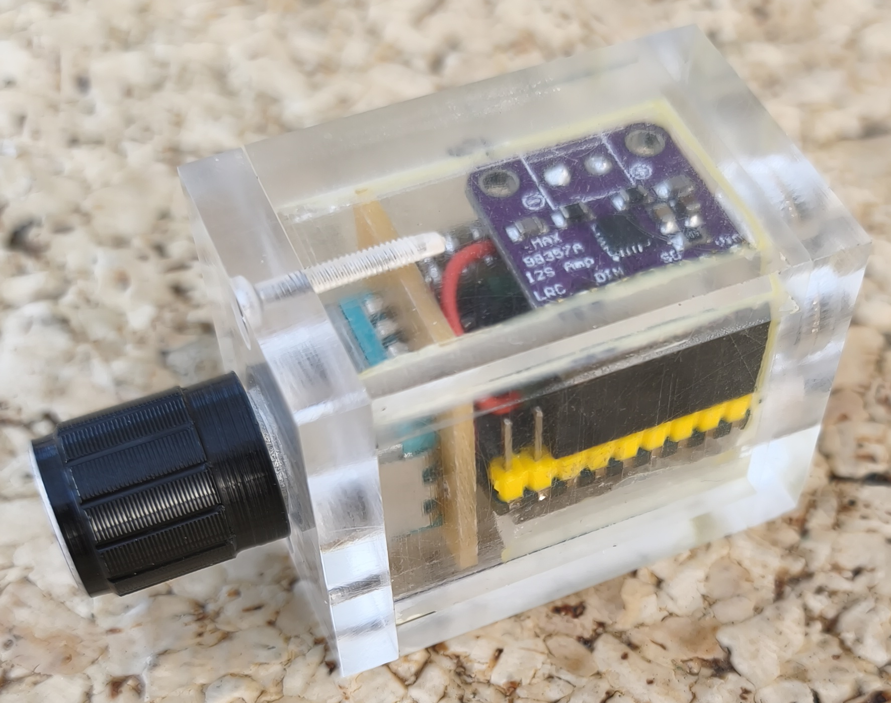
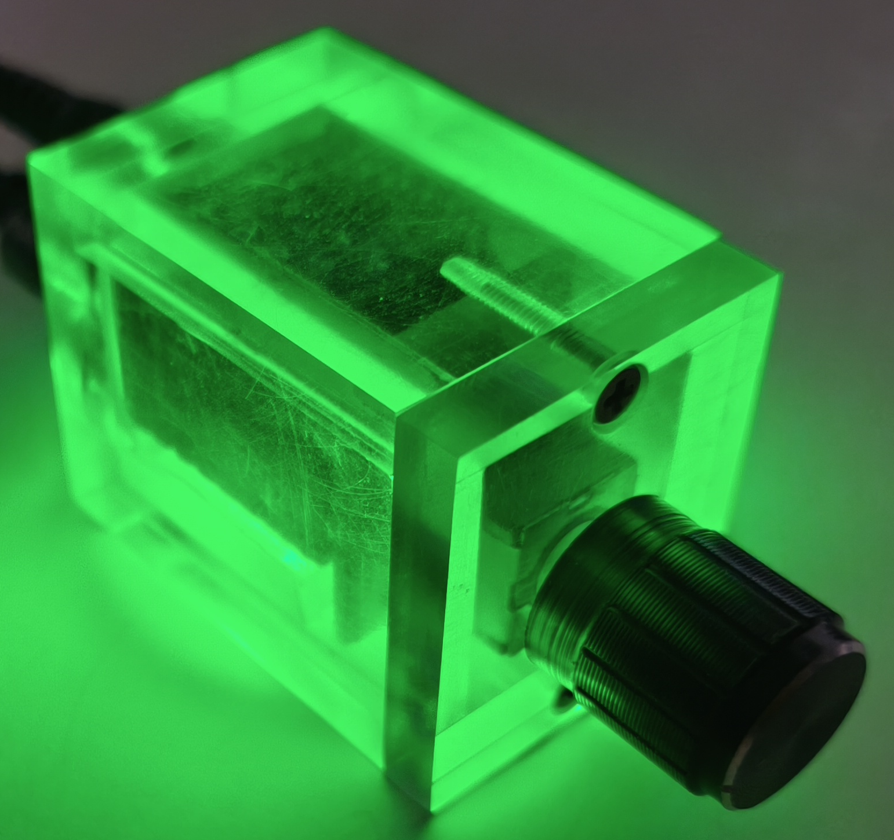
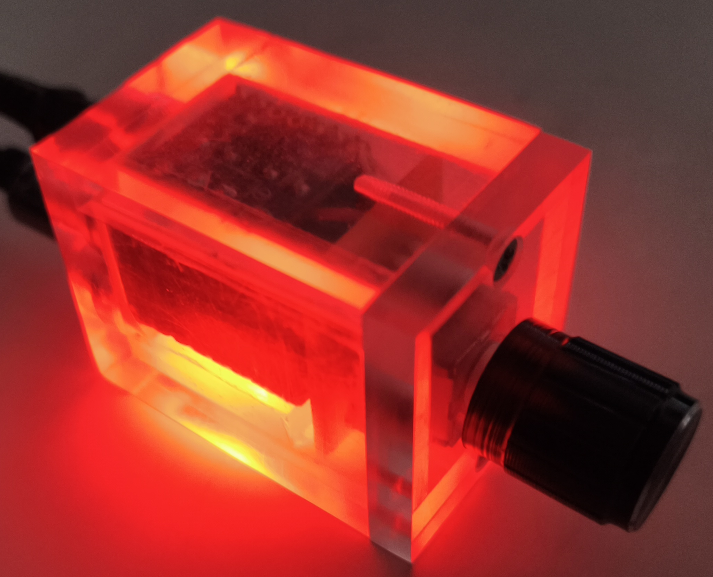

# MiniRadioZero

**MiniRadioZero** is an ultra-minimalist displayless internet radio, specifically designed for environments such as kitchens or workshops, where complex user interfaces or smartphone-based controls are impractical. The device features an elegant hardware "sandwich" architecture built from stacked modules and provides robust physical control through a single mechanical rotary encoder. Visual feedback about the device status is provided by an integrated RGB LED.

Designed as a minimalist counterpart to my previous project [RadioESP32](<https://github.com/Pako2/RadioESP32>) (which is packed with features), this project eliminates all unnecessary user interface overhead. Its goal is simple: to provide smooth and reliable playback of internet radio streams.

### Key Features

- **Ultra-compact hardware sandwich:** Consists of just three components – an ESP32-S3 Zero module, a MAX98357A board (combining an I2S DAC and amplifier), and a mechanical rotary encoder.
- **Zero-Web-Stack architecture:** By completely removing the embedded web server, the firmware eliminates the need for resource-intensive RTOS (Real-Time Operating System) task switching, ensuring completely smooth audio stream processing.
- **Intelligent weekly scheduler:** An autonomous internal scheduler automatically switches stations according to a user-defined timetable. The automatic unmute feature also allows the radio to function as an alarm clock.
- **Hardware efficiency:** Thanks to carefully designed I2S GPIO pin mapping, the microcontroller and DAC board can be connected directly using a five-pin sandwich arrangement, without any jumper wires. The entire module measures just 24 × 18 × 18 mm.
- **Predictable startup behavior:** After power-up, the device always starts with a user-defined default station (unless overridden by a scheduled event) and a safe volume level, preventing unpleasant surprises caused by excessively loud audio.
- **Flexible capacity:** Supports up to 16 radio station presets, up to 8 different Wi-Fi networks (with seamless automatic switching), and up to 32 independent scheduler entries.
- **Centralized configuration:** All settings are defined in a single `config.json` file stored in the LittleFS filesystem, making configuration backups straightforward.
- **Two dedicated deployment tools:** A web portal (available at https://pako2.github.io/MiniRadioZero/portal/index.html) and a PowerShell script are provided for installation, firmware updates, and configuration. Both tools are described in detail below.

## Hardware Connections

### 1\. Connecting the I2S DAC Module (MAX98357A and ESP32-S3 Zero)

Thanks to the selected GPIO pin configuration, the MAX98357A and ESP32-S3 Zero modules can be soldered (or connected using headers) directly back-to-back, forming a compact hardware sandwich:

| **MAX98357A** | **ESP32-S3 Zero** | **Description** |
| --- | --- | --- |
| LRC | GPIO 4 | Word Select / Left-Right Clock |
| BCLK | GPIO 3 | Bit Clock |
| DIN | GPIO 2 | Data In |
| GND | GND | Ground Reference |
| Vin | 5V | 5V Power Rail |

### 2\. Connecting the Rotary Encoder

The rotary encoder can be connected to virtually any available GPIO pins. In this project, the row of pins not occupied by the MAX98357A is used.

Since this row does not provide a physical ground pin, a software workaround is employed: one of the GPIO pins is configured by the firmware as a LOW output, effectively serving as a software ground (`GND`) for the encoder.

| **Encoder Pin** | **ESP32-S3 Zero** | **Description** |
| --- | --- | --- |
| CLK | GPIO 10 | Encoder Clock Pulse |
| DT | GPIO 9 | Encoder Direction Data |
| SWITCH | GPIO 7 | Mechanical Push-Button |
| GND | GPIO 8 | Software-driven Ground Line |

## Configuration File (`config.json`)

All settings are defined in the `config.json` file. A template is provided in the `/data` directory, and the actual configuration is stored in the device's LittleFS filesystem.

json

```json
{
  "defvol": 72,
  "defstat": 0,
  "hostname": "MiniRadioZero",
  "led_order": "RGB",
  "led_bright": 60,
  "led_yel_mix": 80,
  "ntp": {
    "server": "cz.pool.ntp.org",
    "interval": 15,
    "timezone": "CET-1CEST,M3.5.0,M10.5.0/3",
    "tzname": "Europe/Prague"
  },
  "radio": [
    {
      "name": "ČRo Dvojka",
      "url": "http://rozhlas.stream/dvojka_high.aac"
    },
    {
      "name": "ČRo Radiožurnál",
      "url": "https://rozhlas.stream/radiozurnal_high.aac"
    }
  ],
  "scheduler": {
    "sched_enabled": 1,
    "unmute": 1,
    "items": [
      {
        "label": "Default",
        "time": "00:00",
        "wdays": "0123456",
        "station": 0
      },
      {
        "label": "Meteor",
        "time": "08:00",
        "wdays": "6",
        "station": 0
      }
    ]
  },
  "network": [
    {
      "location": "Work",
      "wifibssid": "",
      "wifipass": "ihgf2345",
      "ssid": "Work",
      "dhcp": 1,
      "ipaddress": "",
      "subnet": "",
      "dnsadd": "",
      "gateway": ""
    },
    {
      "location": "Home",
      "wifibssid": "",
      "wifipass": "abcd9876",
      "ssid": "Home",
      "dhcp": 0,
      "ipaddress": "192.168.3.231",
      "subnet": "255.255.255.0",
      "dnsadd": "192.168.3.1",
      "gateway": "192.168.3.1"
    }
  ]
}
```

### Parameter Documentation

**A. Root Parameters**

- `defvol`: Default volume level applied immediately after the device is powered on.
- `defstat`: Index of the default radio station loaded at startup (unless overridden by a scheduled event). The default station can also be restored by triple-clicking the rotary encoder. This serves as an important recovery feature if the user loses track of which station is currently selected.
- `hostname`: Hostname used for network discovery and device identification on the local network.
- `led_order`: RGB LED color channel order. Supported values are `RGB` and `GRB`.
- `led_bright`: RGB LED brightness expressed as a percentage. Valid range: 0–100.
- `led_yel_mix`: Percentage of red in the yellow color mixture. This is usually above 50%, because green tends to overpower red. Valid range: 0–100.

**B. NTP Object (****`ntp`****)**

Configures the SNTP (Simple Network Time Protocol) service, which is essential for scheduler operation.

- `server`: Address of the target NTP server. Choosing a geographically nearby server is recommended (see the [NTP Pool Project Zone List](https://www.ntppool.org/zone/@)).
- `interval`: Time interval between synchronizations, in minutes.
- `timezone`: Time zone definition in the POSIX environment variable format, including daylight saving time rules and UTC offsets. Suitable values for your region can be found in the [POSIX TZ database](<https://raw.githubusercontent.com/nayarsystems/posix_tz_db/master/zones.csv>).
- `tzname`: Human-readable time zone name displayed in system logs (e.g. `Europe/Prague`).

**C. Radio Station Array (****`radio`****)**

A list of your internet radio stations (streams).

- `name`: Descriptive station name displayed in system logs.
- `url`: Direct URL of the internet radio stream (AAC, MP3, etc.).

**D. Scheduler Object (****`scheduler`****)**

- `sched_enabled`: Main switch for enabling (`1`) or disabling (`0`) automatic scheduling.
- `unmute`: When set to `1`, the radio checks whether it is muted when a scheduled event is triggered. If so, audio is automatically unmuted, allowing the radio to function as an alarm clock, for example.
- `items`: List of scheduled events:
  - `label`: Custom descriptive label for user reference (ignored by the main program).
  - `time`: Target execution time in the exact `HH:MM` format.
  - `wdays`: Days of the week on which the rule applies. Sunday is `0`, Monday is `1`, and so on, up to Saturday (`6`). For example, `"0123456"` means every day, while `"6"` means Saturdays only.
  - `station`: Index of the target station in the `radio` array (starting at `0` for the first station).

**E. Network Array (****`network`****)**

A list of up to 8 preconfigured Wi-Fi network profiles.

- `location`: Descriptive name of the network location profile (e.g. `"Home"` or `"Work"`).
- `wifibssid`: MAC address of a specific target access point. Used when multiple access points share the same SSID. Leave empty for normal connection behavior.
- `wifipass`: Wi-Fi network password (security key).
- `ssid`: Unique name of the wireless network (SSID).
- `dhcp`: Set to `1` to automatically obtain network settings from a DHCP server, or `0` to manually configure a static network address.
- `ipaddress` / `subnet` / `dnsadd` / `gateway`: Parameters for static network configuration (required when `dhcp` is set to `0`).

## RGB LED Status Indication

First, it is worth mentioning that ESP32-S3-Zero board manufacturers do not make things particularly easy for us: they use two different types of RGB LEDs on these boards. As a result, earlier firmware versions could sometimes display red instead of green, or vice versa.

Starting with firmware version 1.1.0, the firmware therefore includes an option to configure the LED type. See the Web Portal section for details.

Since the hardware operates entirely without a display, the RGB LED (integrated directly on the ESP32-S3 Zero board at `GPIO 21`) provides real-time visual feedback about every ongoing operation:

| **LED Color** | **Device Status** | **Description** |
| --- | --- | --- |
| Yellow | Startup / Synchronization | Initial state after power-up. The device is waiting to obtain a local IP address via Wi-Fi and/or synchronize its clock with an NTP server. |
| White | Emergency Access Point (AP) | No known Wi-Fi networks were found nearby. The device automatically switches to Access Point (AP) mode to allow configuration and recovery. |
| Green | Active Playback | Normal operating state. The internet radio stream is connected and actively playing through the I2S DAC. |
| Red | Muted | Audio output has been muted by the user using the `Mute` function. |
| Blue | Station Selection / Automatic Switching | Station tuning or switching mode. Activated either manually by double-clicking the rotary encoder or automatically when a scheduled event occurs. |
| Purple | Default Station Restoration | Confirms a triple-click action and indicates that the device is performing a forced return to the predefined default station. |

## Smart Weekly Scheduler and Alarm Clock

### **_Never miss your favorite radio show again\!_**

The autonomous internal scheduling mechanism automatically switches between radio streams throughout the week according to your predefined timetable. Each schedule entry contains a string specifying the days of the week on which that entry is active.

For an explanation of the individual parameters of each entry, see the "Parameter Documentation / Scheduler Object" section above. Here, I will focus on the global scheduler parameters:

- `sched_enabled`: When set to `1`, the internal timer evaluates the scheduled entries. When set to `0`, the scheduler is completely disabled, and the device remains permanently tuned to the station selected by the user (or the default station).
- `unmute`: This parameter controls the radio's adaptive alarm clock behavior. If a scheduled event includes the `unmute: 1` command, the firmware checks whether the device is currently muted. If so, it actively clears the mute state and restores audio output to its operating level, effectively turning the device into a fully autonomous alarm clock. When set to `0`, the radio still switches stations in the background, but the audio output remains muted if mute was previously enabled.

## Rotary Encoder Controls and Gestures

A single mechanical rotary encoder handles the entire user interface through context-sensitive actions and different button press patterns:

- **Normal Operation:**
  - _Rotating the knob:_ Decreases or increases the overall volume.
  - _Single click:_ Immediately toggles between active playback (green LED) and muted mode (red LED).
- **Station Selection (Double Click):**
  - _Double click:_ Activates station selection mode (blue LED).
  - _Tuning:_ Rotate the knob to browse through the list of programmed stations. Since there is no display, the user must keep track of the mechanical steps/clicks by feel.
  - _Confirmation:_ Press the encoder button once to confirm the selection and activate the chosen station. The LED returns to the active playback state (green).
- **Emergency Reset (Triple Click):**
  - _Triple click:_ If you lose track of your position while browsing stations blindly, a triple click immediately switches the radio back to the default station (defined by `defstat` in the `config.json` file).
- **Hardware Reset (Long Press):**
  - _Press and hold for 4 seconds:_ Initiates a complete hardware system restart.

## Deployment, Flashing, and Configuration Tools

Two different tools are available: a web portal and a PowerShell script. Both can be used for initial installation, firmware updates, and, to some extent, configuration. Each has its own advantages and disadvantages, so they can also complement each other in certain situations.

### PowerShell Script – "Flash Utility"

Hardware setup is fully streamlined thanks to an automated deployment framework based on PowerShell.

**Setup Instructions:**

1. Download the latest precompiled deployment package directly: [MiniRadioZero\_bundle.zip](<https://github.com/Pako2/MiniRadioZero/releases/latest/download/MiniRadioZero_bundle.zip>).
2. Extract the ZIP archive into a folder in your local working environment (e.g. `MiniRadioZero-tool`).
3. Open the `MiniRadioZero-tool` root directory and launch the control interface by running `start.bat`.
4. A terminal window will open, displaying the automated PowerShell tool menu:

<p float="left">

</p>

5. Connect the ESP32-S3 Zero hardware module to your computer using a USB data cable.
6. Select `[1] Flash Complete Firmware via USB` to flash the main bootloader, partition layout, and application firmware.
7. Navigate to the extracted folder. Locate `config.json` in the `/filesystem/` directory and edit it using a text editor to match your environment.
   - **_The radio station entries provided here are templates – you can configure up to 16 of your favorite internet streams in the same way._**
   - **_The wireless network profiles are also templates – you can configure up to 8 independent Wi-Fi networks (locations)._**
8. Select `[5] Build and Flash Filesystem Image via USB` to package and deploy your local `config.json` file to the LittleFS partition.

Once the process is complete, the radio starts immediately, connects to the nearest available Wi-Fi network, synchronizes its clock via NTP, and begins playing the stream\!

**Note** (especially for users who prefer a graphical interface): Steps 7 and 8 can be replaced by using the web portal.

### Web Portal

The web portal is available at https://pako2.github.io/MiniRadioZero/portal/index.html. It can be used for initial installation, firmware updates, and configuration.

However, the portal only supports Google Chrome and Microsoft Edge browsers running on a PC. Mobile phones are not supported.

Its greatest advantage is that no additional software needs to be installed on your PC.

You can see several example screenshots of the web portal in the animated image below:

<p float="left">

</p>

**Procedure**

1. Connect the ESP32-S3 Zero hardware module to your computer using a USB data cable.
2. On the `Initial Installation` tab, click the `Upload Firmware to Radio` button.
3. Open the `Configuration` tab and configure the device. Everything is intuitive enough and does not require further explanation.
4. The same tab also contains a `Calibrate LED` button. Clicking it opens a dialog that allows you to calibrate the RGB LED. Since ESP32-S3-Zero boards are manufactured with two different types of LEDs, you first need to identify which type is installed on your board. Do this by clicking either the `Lit up red` or `Lit up green` button.
   You can then use two sliders to adjust the LED brightness and the yellow color tint.
5. Recommended step – click `Save to File`. Having a backup of your configuration is always useful.
6. Click `Write to Radio`. The configuration will be uploaded to the device, and the ESP32 will restart.

If the configuration is correct (especially if at least one valid Wi-Fi network and one valid radio station have been configured), the radio will start immediately after restarting, connect to the nearest available Wi-Fi network, synchronize its clock via NTP, and begin playing the stream\!

### Combining Both Tools

From the previous descriptions, you might get the impression that all communication with the ESP32 takes place exclusively over a cable. However, this is not the case.

The PowerShell script can also communicate with the ESP32 wirelessly using OTA (Over-The-Air) updates. This is particularly useful when the radio is installed somewhere on a shelf, out of reach of your computer.

To use this feature, you need to keep a copy of the configuration file `config.json` on your PC.

**Procedure for Making Additional Configuration Changes Without a USB Connection**

1. Open the web portal at https://pako2.github.io/MiniRadioZero/portal/index.html, navigate to the `Configuration` tab, and click `Read from File`. Select and open the appropriate backup file.
2. Make the required configuration changes.
3. Click `Save to File`. Save the resulting `config.json` file into the `firmware` directory (see the PowerShell script – "Flash Utility" installation instructions).
4. Launch the PowerShell script using `start.bat`.
5. Select `[7] Build and Flash Filesystem Image via OTA` from the menu. Enter the radio's IP address. The configuration will then be uploaded to the device.

## Third-Party Libraries and Acknowledgements

This project relies heavily on the open-source community. I would like to express my sincere gratitude to the authors of the following outstanding libraries, whose hard work made this project possible:

- **[ESP32-audioI2S](<https://github.com/schreibfaul1/ESP32-audioI2S>) by schreibfaul1** – A key component providing high-performance internet radio streaming.
- **[NeoPixel](<https://github.com/adafruit/adafruit_neopixel>) by Adafruit** – An essential library for controlling RGB LEDs.
- **[ArduinoJson](<https://github.com/bblanchon/ArduinoJson>) by bblanchon** – Used for fast and memory-efficient processing of the configuration file.
- **[esptool-js](<https://github.com/espressif/esptool-js>) by Espressif** – A JavaScript implementation of a flashing tool for Espressif chips, running directly in a web browser using WebSerial.

## Slideshow (Including a Handmade PMMA Enclosure)

Below is a gallery of the completed and fully assembled **MiniRadioZero** module.

The hardware was deliberately designed to be easy to assemble without requiring a 3D printer. One example is an enclosure made from 5 mm polymethyl methacrylate (PMMA / acrylic glass) sheets, with all major joints glued together.

Only the front panel housing the mechanical rotary encoder is secured using two screws threaded directly into holes cut into the side panels of the enclosure.

Thanks to the excellent optical properties of PMMA, the entire enclosure becomes a glowing artifact, providing ambient lighting and visual status indication.








### License

The portions of the code created by the author of **MiniRadioZero** are licensed under the GPL-3.0 license. Third-party libraries used in this project are subject to their own licensing terms – you are encouraged to review those as well.